

# TeleGlass

### Жидкое стекло для exteraGram и AyuGram

Размытие, преломление и гибкая настройка интерфейса на базе **Blur3**. 
От главного экрана до мелких деталей внутри чата и не только.

**[Скачать](https://github.com/kirillyanch/TeleGlass/releases/latest)** · **[Скриншоты](#скриншоты)** · **[Установка](#установка)** · **[Сообщить об ошибке](https://github.com/kirillyanch/TeleGlass/issues)**

Если Вам нравится проект — поддержите его звездой ⭐

# Знакомый интерфейс, новое ощущение

TeleGlass превращает привычные панели, вкладки и кнопки в стеклянные
поверхности с живым фоном, мягким размытием и преломлением.

Плагин использует штатный Blur3 и меняет оформление, сохраняя
привычные нажатия, свайпы, прокрутку и логику работы клиента. Можно включить
всё сразу или оставить стекло только там, где оно нравится Вам.

# Возможности

- **Главный экран** — шапка, поиск, папки и нижняя навигация.
- **Внутри чата** — поле ввода, закреп, перевод, кнопки и дополнительные панели.
- **Медиа и профиль** — вкладки, «Избранное» и элементы быстрой прокрутки.
- **Эмодзи** — независимые переключатели для вкладок и кнопок.
- **Мини-плеер и даты** — стеклянные капсулы и тёмный текст плавающих дат в светлой теме.
- **Своё оформление** — отдельные цвета и плотность для светлой и тёмной тем, настройка контура и преломления.
- **Четыре пресета** — Максимальный, Повышенный, Стандартный и Минимальный.
- **Управление нагрузкой** — частота захвата фона и облегчённый режим для кружков, сохраняющий размытие без преломления.
- **Обмен настройками** — импорт и экспорт конфигурации в `.teleglass`.

При отключении эффектов плагин восстанавливает исходное оформление.

# Демонстрация

https://github.com/user-attachments/assets/dababd48-58d7-4bd0-8657-1f94a0e8808a

Канал · Чат · Поиск

# Скриншоты

## Главный экран

Стеклянные капсулы шапка со сторис и действиями, папки чатов, нижняя навигация и поиск на главной странице.

  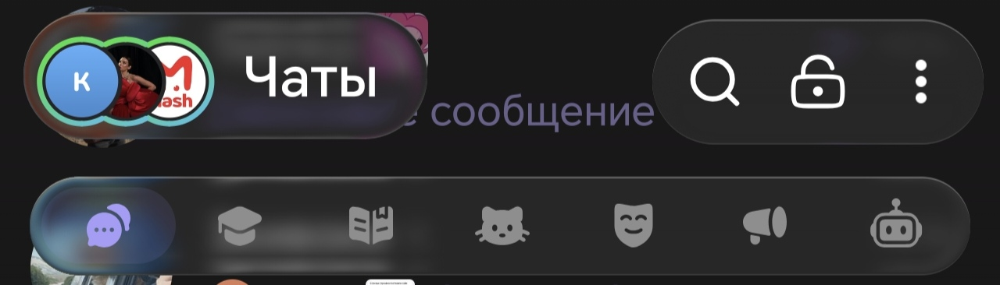

  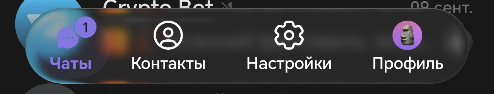

  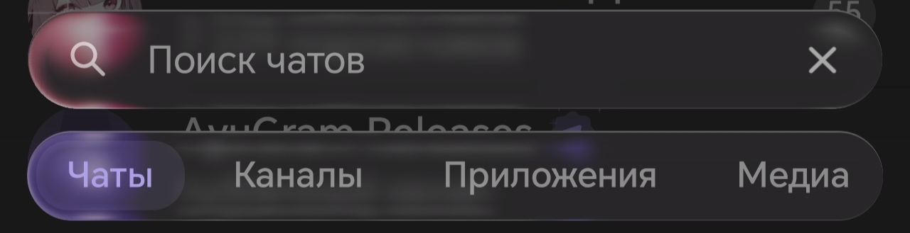

## Внутри чата

Стеклянные капсулы шапки чата, закрепленных сообщений, перевода, поля ввода, плеера и плавающая дата.  

  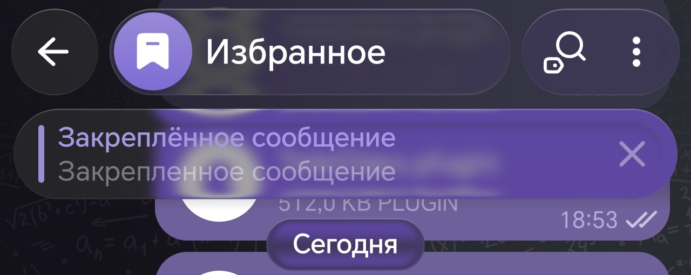

  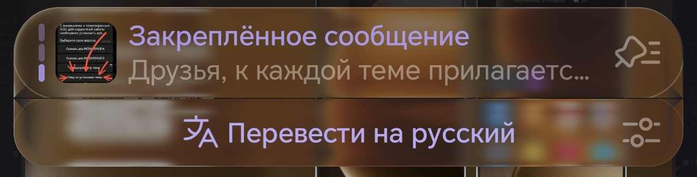

  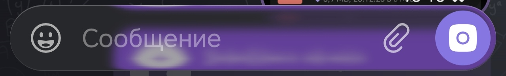

  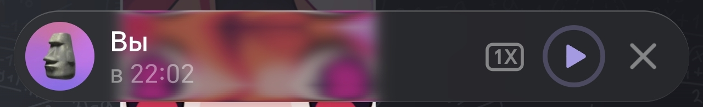

  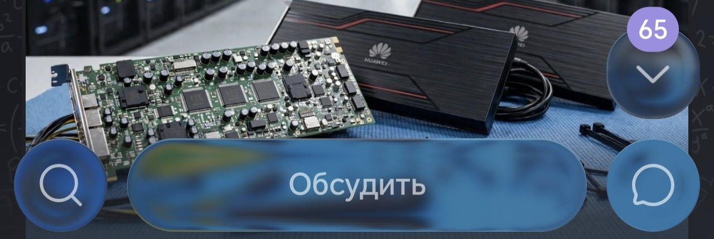

## Панель эмодзи, GIF и стикеров

Стеклянные капсулы переключения между эмодзи, GIF, стикерами и кнопки настроек/удаления.

  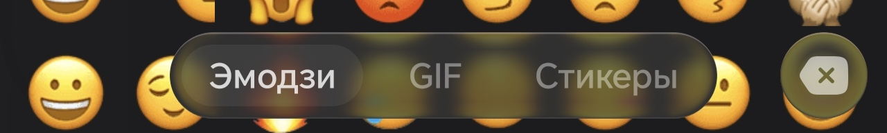

## Галерея и вложения

Стеклянная капсула шапки галереи и переключения между типами вложений.

  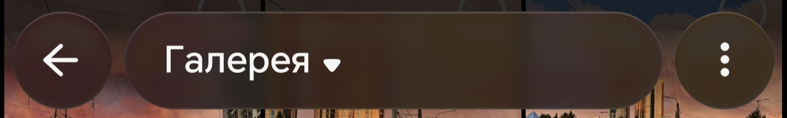

  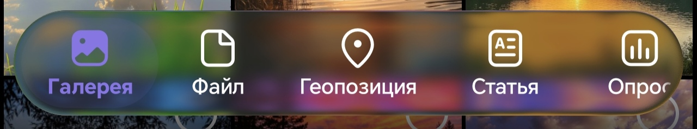

## Настройки exteraGram и AyuGram

Стеклянные капсулы шапки настроек exteraGram и AyuGram.

  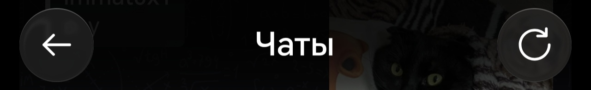

# Установка

1. Скачайте **`TeleGlass.plugin`** из раздела **Assets** в [последнем релизе](https://github.com/kirillyanch/TeleGlass/releases/latest).
2. Установите файл через систему плагинов **exteraGram** или **AyuGram**.
3. Включите TeleGlass и выберите пресет в настройках плагина.
4. После смены пресета рекомендуется полный перезапуск клиента.

> Требуется Android 10 версии или выше и сборка exteraGram
> или AyuGram начиная с версии 12.10.6 с поддержкой плагинов.
> Доступность эффектов и производительность зависят от клиента,
> версии Android и устройства.

**[TeleGlass](https://github.com/kirillyanch/TeleGlass)** · [MIT License](LICENSE) 
Независимый проект. Не является официальным компонентом Telegram, exteraGram или AyuGram.

